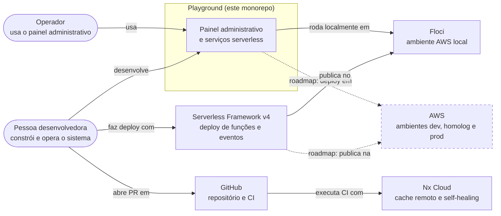
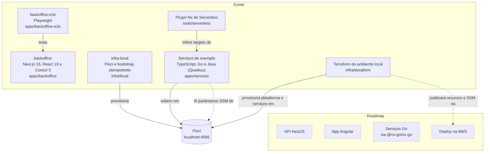
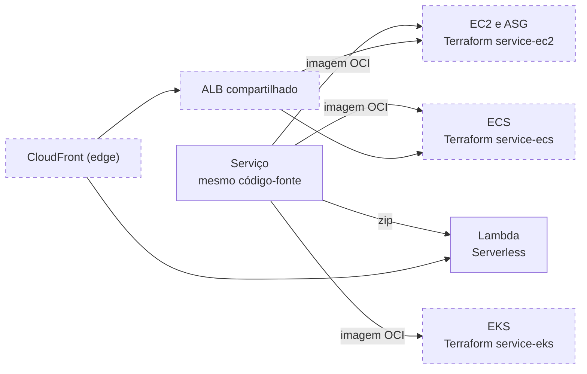
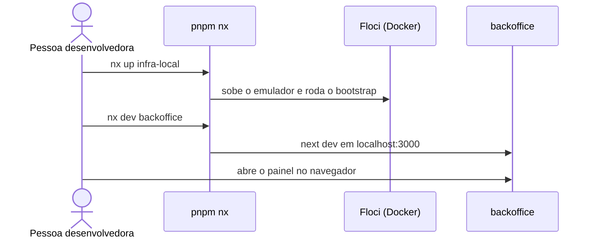
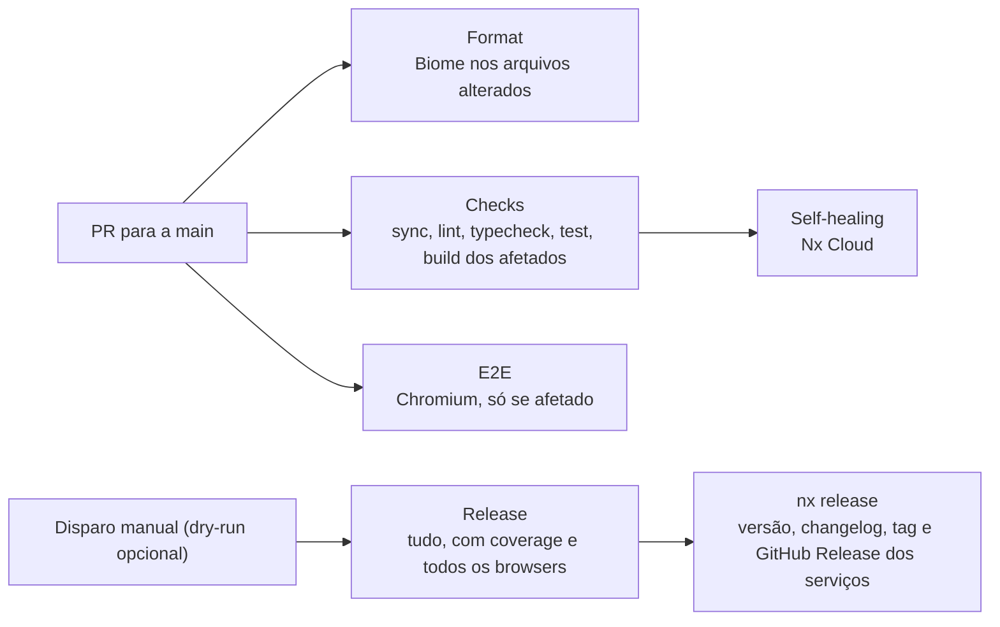

# Visão de arquitetura

Visão em dois níveis do modelo C4: **contexto** (o sistema e quem se relaciona com ele) e **containers** (as partes executáveis e implantáveis). Os diagramas usam [Mermaid](https://mermaid.js.org/), que o GitHub renderiza.

Cada elemento tem um status:

| Status      | Significado                                                      |
| ----------- | ---------------------------------------------------------------- |
| **Existe**  | Está no repositório e funciona.                                  |
| **Roadmap** | Planejado. **Não existe** e nenhum código deve supor que existe. |

## Nível 1: contexto



- O **Operador** é o único usuário final previsto: quem administra o sistema pelo painel.
- O **Floci** é o único ambiente AWS virtualizado ([ADR 0002](../adr/0002-floci-ambiente-aws-local.md)). A **AWS real** ainda não é alvo de deploy: é roadmap.
- O **GitHub** hospeda o código e roda o CI; o **Nx Cloud** dá o cache remoto e a correção automática de falhas do CI.

## Nível 2: containers



### Containers que existem

| Container                   | Pasta                                                        | Tecnologia                                                        | Responsabilidade                                                                                                                                                                                                                                                                                                                                                |
| --------------------------- | ------------------------------------------------------------ | ----------------------------------------------------------------- | --------------------------------------------------------------------------------------------------------------------------------------------------------------------------------------------------------------------------------------------------------------------------------------------------------------------------------------------------------------- |
| **backoffice**              | `apps/backoffice`                                            | Next.js 16.4, React 19, CoreUI Free 5.x                           | Painel administrativo: shell com menu por permissão, tema, breadcrumb, estados, toast e modal. Build `standalone`.                                                                                                                                                                                                                                              |
| **backoffice-e2e**          | `apps/backoffice-e2e`                                        | Playwright                                                        | Testes de ponta a ponta do shell. Por padrão roda só o Chromium.                                                                                                                                                                                                                                                                                                |
| **infra-local**             | `infra/local`                                                | Docker Compose, Floci, AWS CLI                                    | Sobe o ambiente AWS local e provisiona buckets, filas, tabelas e parâmetros SSM de forma idempotente.                                                                                                                                                                                                                                                           |
| **Terraform local**         | `infra/terraform`                                            | Terraform 1.11 ou mais novo                                       | Provisiona no Floci a plataforma (rede, ECR, ALB, cluster ECS e EKS opcional) e os serviços de container em EC2, ECS ou EKS, com o contrato no SSM. Veja o [README](../../infra/terraform/README.md).                                                                                                                                                           |
| **Plugin Nx de Serverless** | `tools/serverless` (projeto `nx-serverless`)                 | TypeScript, `@nx/devkit`                                          | Infere os targets de cada serviço (`pre-deploy`, `package`, `deploy`, `remove`, `invoke-local` e, em Go e Java, `build`), com uma configuration por stage (`floci`, `dev`, `homolog`, `prod`). Traz os executors `validate` e `go-build` e os generators `service-ts` e `service-go` (o `service-java` ainda não existe) (eventos `http`, `sqs` e `scheduled`). |
| **Serviços de exemplo**     | `apps/services/example-ts`, `example-go` e `example-quarkus` | Serverless Framework v4, Node 24, Go e Java 21 (Quarkus e Gradle) | Referência de como um serviço é montado e implantado no Floci, uma por stack. O Java é um build Gradle na raiz, com o núcleo em Java puro (`example-quarkus-core`) e a aplicação Quarkus (`example-quarkus`).                                                                                                                                                   |

O Java entra no Nx pelo `@nx/gradle` (que também cria o projeto `playground`, a raiz do build Gradle) e usa o Gradle 9.7.0 pelo wrapper `./gradlew`; o build nativo roda em container (Docker). Veja a seção [Serviço Java (Quarkus)](../guides/servico-serverless.md#serviço-java-quarkus).

O fluxo de criação e deploy está no guia [Serviço serverless](../guides/servico-serverless.md). O deploy na AWS continua no roadmap.

### Roadmap

Nenhum destes existe ainda:

| Item                      | Observação                                                                                                                                                                                                                        |
| ------------------------- | --------------------------------------------------------------------------------------------------------------------------------------------------------------------------------------------------------------------------------- |
| **API NestJS**            | Backend HTTP tradicional, ao lado das funções serverless.                                                                                                                                                                         |
| **App Angular**           | Bloqueado pelo setup TypeScript solution; decisão em aberto no [ADR 0005](../adr/0005-angular-no-setup-ts-solution.md).                                                                                                           |
| **Go via `@nx-go/nx-go`** | Libs e serviços Go gerenciados pelo Nx.                                                                                                                                                                                           |
| **Terraform na AWS real** | `envs/dev`, `homolog` e `prod`, state remoto, camadas L0, L2 e L5 e a organização, cada um quando o gatilho do [ADR 0011](../adr/0011-estrutura-profissional-do-terraform.md) acontecer.                                          |
| **Deploy na AWS**         | Dev, homolog e prod. Hoje só o Floci é alvo.                                                                                                                                                                                      |
| **Adapters de runtime**   | Entrypoints por serviço ([ADR 0008](../adr/0008-adapters-de-runtime.md)). Parcial: o Go já escolhe Lambda ou HTTP por `AWS_LAMBDA_RUNTIME_API`, e o Go e o Quarkus têm imagem OCI; falta o entrypoint de container em TypeScript. |

## Direção da arquitetura

Três decisões orientam o que vem pela frente. Os detalhes estão nos ADRs; aqui fica o resumo.

1. **Tudo roda no Floci localmente**, inclusive a implantação do frontend como se fosse na AWS ([ADR 0002](../adr/0002-floci-ambiente-aws-local.md)).
2. **O backend é serverless por preferência**, mas com **adapters de runtime**: o mesmo código-fonte vai para Lambda, ECS, EKS ou EC2 por opção de deploy ([ADR 0008](../adr/0008-adapters-de-runtime.md)).
3. **A infraestrutura é compartilhada** entre os manifestos Serverless e o Terraform, com **um único dono por recurso** e referência cruzada só pelo SSM ([ADR 0004](../adr/0004-serverless-e-terraform.md)).

> **Hoje** existem o Floci, o plugin Nx de Serverless, as Lambdas de exemplo, que já separam núcleo e entrypoint (em Go, o mesmo binário sobe como Lambda ou como servidor HTTP), as imagens OCI do `example-go` e do `example-quarkus` e o Terraform do ambiente local (L1 e L4), provado no Floci. As demais camadas e o `contract:check` estão **a implementar**.

### Quem é dono de quê

| Dono           | Cuida de                                                                                                                                                                           |
| -------------- | ---------------------------------------------------------------------------------------------------------------------------------------------------------------------------------- |
| **Terraform**  | Rede, ECR, clusters ECS e EKS, EC2 e ASG, ALB, CloudFront, Cognito, RDS, IAM base, tudo que guarda dado ou é compartilhado, e os backends em container. Publica o contrato no SSM. |
| **Serverless** | As funções Lambda de cada serviço e os eventos que as disparam.                                                                                                                    |

A regra de dono, aplicada em ordem, está no [ADR 0004](../adr/0004-serverless-e-terraform.md#2-regra-de-dono-aplicada-em-ordem): dado que sobrevive ao código, recurso usado por 2 ou mais serviços, fundação de rede, segurança ou identidade, e backend em container são do **Terraform**; o que pertence 1:1 a uma Lambda e pode morrer com ela é do **Serverless**. O contrato é o SSM, em `/playground/<stage>/<região>/<domínio>/<recurso>/<atributo>`, e um lado nunca lê o state do outro.

### Camadas e ordem

`L0 bootstrap`, `L1 platform`, `L2 data`, `L3 artefatos`, `L4 serviços`, `L5 edge` e `L6 verificação`. Cria-se nessa ordem; a dependência aponta só para camadas de número menor. Veja o [ADR 0009](../adr/0009-camadas-e-ordem-de-implantacao.md) e o [guia de ordem de implantação](../guides/ordem-de-implantacao.md).

### Estrutura planejada (parcial)

```text
infra/terraform/modules/*
infra/terraform/envs/<stage>/{bootstrap,platform,data,services,edge}
apps/services/<svc>/serverless.yml        (já existe para os exemplos)
```

No `envs/local`, o provider do Terraform aponta para o Floci. Hoje existem só `modules/*` (8 módulos) e `envs/local/{platform,services}`; o resto da árvore entra por gatilho ([ADR 0011](../adr/0011-estrutura-profissional-do-terraform.md)).

## Destinos de deploy

Um serviço escolhe o destino por **opção de deploy**, sem mudar o código. Cada destino tem um dono de infraestrutura e uma emulação no Floci.



| Destino           | Artefato   | Dono da infra           | Como o Floci emula (segundo a documentação dele)                                       |
| ----------------- | ---------- | ----------------------- | -------------------------------------------------------------------------------------- |
| **Lambda**        | Zip        | Serverless              | Funções e Lambda Web Functions, que encaminham requisições. **Já usado** nos exemplos. |
| **EC2** (com ASG) | Imagem OCI | Terraform `service-ec2` | Instâncias EC2 são containers Docker.                                                  |
| **ECS**           | Imagem OCI | Terraform `service-ecs` | Tasks ECS rodam como containers reais.                                                 |
| **EKS**           | Imagem OCI | Terraform `service-eks` | Sobe clusters k3s reais.                                                               |
| **ALB e NLB**     | -          | Terraform               | Encaminham tráfego.                                                                    |
| **CloudFront**    | -          | Terraform, camada edge  | Encaminha para as origens.                                                             |

> **Atenção:** a coluna do Floci vem da documentação do branch `main` do projeto e **ainda não foi testada na versão 2.4.0** fixada aqui. Só o caminho Lambda foi exercitado.

O contrato de execução que permite trocar de destino sem mudar o código (artefato único, configuração por ambiente e SSM, `PORT`, `/health`, logs JSON, `SIGTERM` e serviço stateless) está no [ADR 0008](../adr/0008-adapters-de-runtime.md).

## Estágios de evolução

O modelo é **evolutivo e incremental**.

| Estágio            | Quando                             | Backends                                                                                                                             | Lambdas               |
| ------------------ | ---------------------------------- | ------------------------------------------------------------------------------------------------------------------------------------ | --------------------- |
| **1. Início**      | 2 a 3 backends                     | Cada um em uma EC2 micro própria (ASG de 1 instância por serviço), atrás de um **ALB compartilhado** com roteamento por path ou host | 1 a 2, via Serverless |
| **2. Crescimento** | Os backends migram de EC2 para ECS | **Tasks ECS** no mesmo ALB, com target groups novos                                                                                  | Seguem                |
| **3. Escala**      | Os serviços migram para EKS        | **EKS**, com ingress próprio                                                                                                         | Seguem                |

Invariantes que permitem migrar sem mudar o código:

- **Artefato único por serviço**: uma imagem OCI construída uma vez, com a tag imutável `sha-<commit>`, usada em EC2, ECS e EKS. O zip continua para a Lambda. No release, o mesmo digest ganha também a tag semântica `<versão>`, sem rebuild.
- Configuração por variável de ambiente e SSM canônico; segredos no Secrets Manager.
- `PORT`, health em `/health`, logs JSON no stdout, shutdown gracioso no `SIGTERM` e serviço stateless.

A migração entre estágios é **blue/green no ALB**, com target groups ponderados: sobe o novo, desloca o peso e desliga o antigo.

Dono por estágio: o Terraform cuida dos módulos `service-ec2`, `service-ecs` e `service-eks` e da plataforma; o Serverless cuida das Lambdas; o plugin Nx escolhe o deploy pelo destino declarado no projeto.

**Risco da EC2, resolvido na PoC**: no Floci, a instância EC2 é um container privilegiado, e o Docker aninhado (com `tmpfs` em `/var/lib/docker` e o host do ECR apontado para o `floci`) roda a mesma imagem de ECS e EKS. O artefato continua único e o fallback com systemd não foi preciso ([ADR 0008](../adr/0008-adapters-de-runtime.md) e [módulo `service-ec2`](../../infra/terraform/modules/service-ec2/README.md)).

## Decisões adiadas (gatilhos)

Decisões conhecidas e **deliberadamente não construídas**. Cada uma entra quando o gatilho acontecer, e não antes: até lá, deploy pequeno e `git revert` bastam.

| Decisão                                                                                        | Gatilho para adotar                                                                                                                  |
| ---------------------------------------------------------------------------------------------- | ------------------------------------------------------------------------------------------------------------------------------------ |
| Feature flag em runtime (AWS AppConfig) e deploy canário de Lambda (alias ponderado)           | Primeira funcionalidade real em produção                                                                                             |
| Store de idempotência para consumidores SQS (DynamoDB com escrita condicional, em L2)          | Primeiro consumidor com efeito colateral                                                                                             |
| Target `rollback` do Serverless (`serverless rollback --timestamp`) e o runbook correspondente | Primeiro deploy em `dev`                                                                                                             |
| `enabled` por configuração nos eventos de fila e de agendamento                                | Primeiro deploy em `dev`, junto do rollback                                                                                          |
| OpenTelemetry e propagação de `traceparent`                                                    | Quando o primeiro serviço chamar outro, ou quando o primeiro deploy em `dev` precisar de rastreamento                                |
| Sampling e rate limit de log                                                                   | Quando o custo de ingestão passar de um teto definido, ou quando uma tempestade de mensagens envenenadas atrapalhar uma investigação |
| Schema de wide events                                                                          | Quando uma investigação precisar cruzar mais de duas linhas                                                                          |
| Log de erro do painel no servidor (`onRequestError` do Next)                                   | No primeiro deploy com usuários reais                                                                                                |

No `enabled` por configuração, o `${ssm:}` do Serverless devolve **string**. Testado no Floci com `serverless print`: só `true` e `false` (minúsculos) viram booleano, e `False`, `0` ou `off` falham com `must be boolean`. Teste o valor do parâmetro com `serverless print` antes de adotar.

## Decisões que moldam a arquitetura

| Tema                                           | ADR                                                          |
| ---------------------------------------------- | ------------------------------------------------------------ |
| Orquestração, gerenciador de pacotes, TS       | [0001](../adr/0001-nx-pnpm-ts-solution.md)                   |
| Ambiente AWS local                             | [0002](../adr/0002-floci-ambiente-aws-local.md)              |
| Interface do painel                            | [0003](../adr/0003-coreui-free-no-backoffice-nextjs.md)      |
| Divisão entre Serverless Framework e Terraform | [0004](../adr/0004-serverless-e-terraform.md)                |
| Angular                                        | [0005](../adr/0005-angular-no-setup-ts-solution.md)          |
| Versão do Next.js e dev origins                | [0006](../adr/0006-next-16-4-6-e-allowed-dev-origins.md)     |
| Lint e formatação                              | [0007](../adr/0007-lint-e-formatacao-biome-eslint-minimo.md) |
| Adapters de runtime (Lambda, ECS, EKS, EC2)    | [0008](../adr/0008-adapters-de-runtime.md)                   |
| Camadas e ordem de implantação                 | [0009](../adr/0009-camadas-e-ordem-de-implantacao.md)        |
| Versionamento e publicação no GitHub           | [0010](../adr/0010-versionamento-e-publicacao-no-github.md)  |

## Fluxos principais

### Desenvolvimento local



### Integração contínua



O `.github/workflows/ci.yml` roda em pull requests e em push na `main` e cobre só o que mudou. O `.github/workflows/release.yml` é o nível completo, disparado só manualmente, e depois da validação roda o `nx release` ([ADR 0010](../adr/0010-versionamento-e-publicacao-no-github.md)).

## Fronteiras e regras de dependência

- Projetos se ligam por **dependências de workspace do pnpm** e project references do TypeScript, não por `paths`.
- As tags `scope:*` e `type:*` rotulam os projetos. A regra `@nx/enforce-module-boundaries` está ativa, mas hoje não restringe nada: ao surgirem as primeiras libs, defina as restrições por tag (veja o [guia de tarefas do Nx](../guides/nx-tarefas.md#tags-e-fronteiras)).
- Segredos nunca entram em `NEXT_PUBLIC_*` nem em arquivos versionados.
